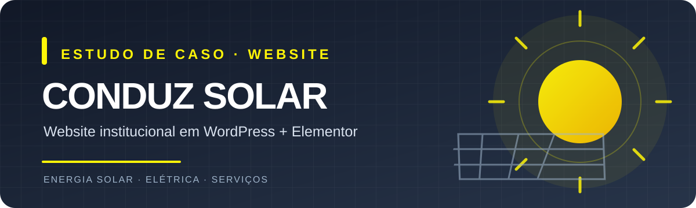

# Conduz Solar | Website Institucional

> Estudo de caso de desenvolvimento e organização de um website institucional para uma empresa de soluções em energia solar, instalações elétricas e serviços mecânicos.

**Site público:** https://conduzsolar.com.br/

Este repositório documenta o projeto do website da Conduz Solar como peça de portfólio. O site publicado utiliza WordPress e Elementor. O repositório reúne documentação, mapa de conteúdo, decisões de apresentação e espaço para registrar customizações e capturas de tela autorizadas.

## Visão geral

O website apresenta a empresa, suas áreas de atuação, serviços, produtos, portfólio, depoimentos e canais de contato. A arquitetura de conteúdo procura conduzir o visitante da apresentação institucional ao conhecimento das soluções oferecidas e, por fim, ao contato comercial.

### Objetivos do website

- Apresentar a Conduz Solar e seu posicionamento institucional.
- Organizar as soluções oferecidas em categorias compreensíveis.
- Explicar serviços de energia solar, elétrica e mecânica.
- Dar visibilidade a projetos, produtos e depoimentos.
- Facilitar solicitações de orçamento e contato por canais comerciais.
- Oferecer uma experiência navegável em computadores e dispositivos móveis.

## Estrutura de conteúdo observada

A navegação pública do site contém as seguintes áreas:

| Área | Finalidade |
|---|---|
| Home | Apresentação da empresa, proposta de valor e principais chamadas para ação. |
| Serviços | Organização das soluções residenciais, comerciais e industriais. |
| Portfólio | Espaço para apresentar trabalhos e projetos executados. |
| Nossos Produtos | Apresentação do catálogo de produtos e soluções. |
| Blog | Conteúdos informativos e institucionais. |
| Sobre | História, valores, missão e posicionamento da empresa. |
| Contato | Canais para iniciar uma conversa e solicitar atendimento. |

## Serviços apresentados

O conteúdo público apresenta, entre outros, serviços de instalação e manutenção de sistemas solares, instalações elétricas residenciais e industriais, montagem de painéis e infraestrutura elétrica, monitoramento, iluminação personalizada e consultoria técnica.

## Tecnologias e ambiente

- **WordPress:** sistema de gerenciamento de conteúdo (CMS) utilizado pelo website.
- **Elementor:** construtor visual utilizado na edição das páginas.
- **HostGator:** hospedagem informada para o ambiente do site.
- **HTML, CSS e JavaScript:** tecnologias web relacionadas à estrutura, apresentação e interações. Registre aqui somente customizações que tenham sido efetivamente desenvolvidas ou alteradas no projeto.

> Importante: este repositório não contém uma cópia executável do WordPress. O WordPress depende de PHP, banco de dados e ambiente de hospedagem. O GitHub é utilizado aqui para documentar o projeto e versionar arquivos próprios e autorizados, não para substituir a hospedagem do site.

## Experiência do usuário e conteúdo

O projeto organiza a informação em uma sequência que ajuda o visitante a:

1. Entender a proposta da Conduz Solar.
2. Identificar as áreas de atuação.
3. Explorar os serviços e soluções.
4. Consultar elementos de confiança, como portfólio e depoimentos.
5. Encontrar os canais de contato e orçamento.

## Minha participação

Este estudo de caso deve ser apresentado de acordo com as atividades realmente executadas. Personalize esta seção antes de divulgar o repositório:

- [ ] Planejamento da estrutura e navegação do site.
- [ ] Criação e organização de páginas no WordPress.
- [ ] Construção/edição visual de páginas com Elementor.
- [ ] Redação, revisão ou organização de textos institucionais.
- [ ] Inserção e organização de imagens e conteúdos.
- [ ] Ajustes responsivos para desktop, tablet e celular.
- [ ] Personalizações em CSS, HTML ou JavaScript.
- [ ] Configurações de formulários, links e chamadas para ação.
- [ ] Publicação e manutenção do website.

Marque apenas as atividades que você realmente realizou. Se alguma parte foi feita por outra pessoa, fornecedor ou tema/plugin, não a atribua a si mesma.

## Capturas de tela

A pasta [`screenshots/`](screenshots/) contém instruções para adicionar capturas próprias do site. Utilize imagens autorizadas e remova dados pessoais, informações de clientes e elementos administrativos do WordPress.

## Customizações

A pasta [`custom-code/`](custom-code/) pode receber CSS, HTML ou JavaScript autoral utilizado no projeto, desde que você tenha autorização para publicá-lo. Não inclua arquivos de plugins ou temas comerciais, credenciais, chaves, tokens ou código proprietário de terceiros.

## Documentação

- [Visão e escopo do projeto](documentation/visao-geral.md)
- [Mapa do site e arquitetura de conteúdo](documentation/mapa-do-site.md)
- [Tecnologias, hospedagem e limites](documentation/tecnologias-e-arquitetura.md)
- [Checklist de publicação segura](documentation/publicacao-segura.md)

## Limitações deste repositório

- Não é backup do WordPress.
- Não contém banco de dados, mídia integral ou arquivos do servidor.
- Não deve receber `wp-config.php`, backups, credenciais ou dados de clientes.
- O repositório não reproduz automaticamente o website; o site oficial continua publicado na hospedagem da Conduz Solar.

---

**Website:** https://conduzsolar.com.br/  
**Plataforma:** WordPress + Elementor  
**Tipo de projeto:** Website institucional / estudo de caso de portfólio
